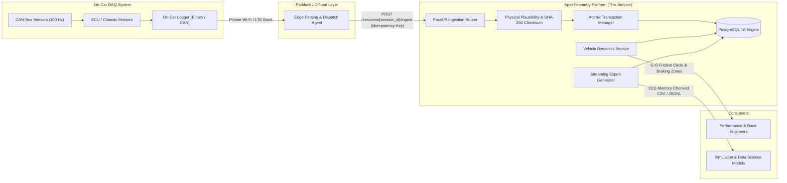
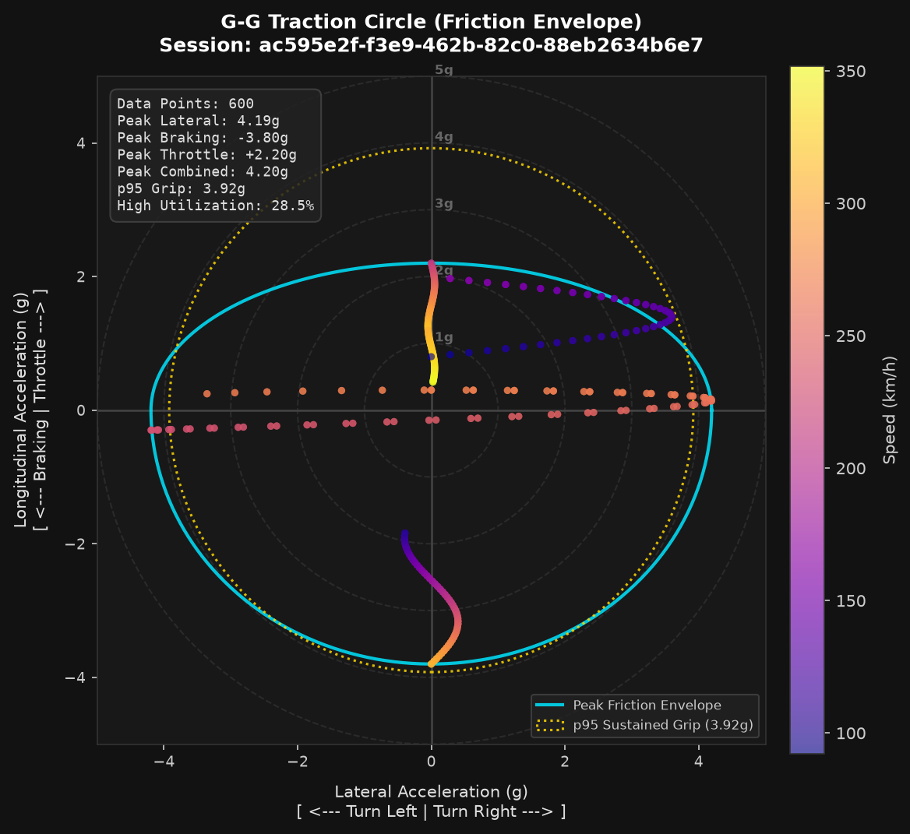

# ApexTelemetry Platform

[](https://github.com/arch3ese/apex-telemetry/actions)
[](https://www.python.org/)
[](https://fastapi.tiangolo.com/)
[](https://www.postgresql.org/)
[](https://www.sqlalchemy.org/)
[](https://github.com/astral-sh/ruff)

Asynchronous telemetry ingestion, session management, and vehicle dynamics analysis platform built with FastAPI, PostgreSQL, and SQLAlchemy 2.0. Engineered for post-run trackside offload, atomic multi-channel batch ingestion, and vehicle dynamics performance analysis.

---

## Architecture and Domain Context

In automotive and motorsport testing, on-car Data Acquisition (DAQ) loggers (e.g. MoTeC, Bosch Motorsport, AiM) record raw CAN-bus sensor channels to binary formats (`.ld`, `.mdf4`) at frequencies between 10 Hz and 1000 Hz. 

When a vehicle returns to the pitlane, or transmits telemetry bursts over trackside Wi-Fi/LTE, data is offloaded to central engineering services. Raw binary dumps must be parsed into structured session datasets for cross-session driver comparison, powertrain shift analysis, and tire friction modeling.

ApexTelemetry operates as the post-session engineering platform responsible for:
1. **Idempotent Ingestion:** Preventing data duplication when network retries occur over lossy paddock Wi-Fi.
2. **Transactional Atomicity:** Rolling back partially failed batch uploads to ensure corrupted sensor slices never reach analytical models.
3. **Physical Domain Validation:** Enforcing plausible vehicle bounds (e.g. non-negative brake line pressure, realistic wheel speeds, and grip bounds).
4. **Vehicle Dynamics Analysis:** Computing G-G friction traction circles, corner apex speeds, trail braking decay, and powertrain gear ratios from synchronized channel observations.
5. **Bounded Memory Streaming:** Exporting large multi-lap datasets as CSV and JSONL using server-side database cursors without exhausting server RAM.



---

## Core Engineering Guarantees

- **Database-Enforced Idempotency:** Client retries using the `Idempotency-Key` header leverage a composite `UNIQUE(session_id, idempotency_key)` constraint. Duplicate requests return `200 OK` with `is_idempotent_replay: true` and write 0 duplicate rows to PostgreSQL, eliminating time-of-check to time-of-use (TOCTOU) race conditions.
- **Payload Integrity Verification:** A deterministic SHA-256 checksum of batch readings identifies payload mutation or key collisions (`409 Conflict`).
- **Atomic Batch Rollback:** Batches are committed within isolated transactions. If any observation violates schema constraints (e.g., unique timestamp or quality flag range), the entire batch is rolled back and an audit failure record is logged in `ingestion_jobs`.
- **Physical Plausibility Bounds:** Validates sensor limits (brake pressure $[0.0, 250.0]\,\text{bar}$, wheel speeds $[0.0, 450.0]\,\text{km/h}$, acceleration $[-5.0, +5.0]\,g$).
- **Constant Memory O(1) Streaming:** Database server-side cursors (`stream_scalars()`) pipe chunked CSV and JSONL datasets directly over HTTP sockets, maintaining flat memory usage regardless of dataset size.
- **Keyset Cursor Pagination:** Paginated queries utilize composite index traversal `(recorded_at, id)` to prevent page-drift anomalies during concurrent inserts.

---

## Vehicle Dynamics Analysis Engine

ApexTelemetry includes an analysis service ([`src/apex_telemetry/services/analysis_service.py`](src/apex_telemetry/services/analysis_service.py)) for vehicle dynamics and powertrain data:

### 1. G-G Diagram and Tire Grip Utilization
Computes the lateral vs. longitudinal acceleration friction ellipse:
$$\text{Resultant Acceleration } a_{\text{comb}} = \sqrt{a_{\text{lat}}^2 + a_{\text{long}}^2}$$
Calculates peak cornering grip, peak braking deceleration, 95th percentile sustained grip, and the percentage of lap time spent at high tire utilization ($\ge 80\%$ of peak grip).

Also renders high-resolution G-G diagrams (`GET /api/v1/sessions/{session_id}/analysis/traction-circle/plot` or CLI `scripts/plot_gg_diagram.py`) with concentric g-rings, speed-mapped scatter points, and friction envelope overlays:

<p align="center">
  
</p>

### 2. Braking Zones and Corner Apex Dynamics
Detects sustained braking phases ($a_{\text{long}} \le -0.6g$ or brake line pressure $> 5\,\text{bar}$), recording:
- Brake initiation speed
- Corner apex minimum speed ($V_{\text{min}}$)
- Speed loss ($\Delta V$) and peak deceleration ($g$)

### 3. Powertrain Transmission Analysis
Analyzes transmission shift points and gear transitions:
- Identifies upshift events where engine speed drops rapidly while vehicle velocity is maintained.
- Calculates pre-shift RPM, landing RPM, and RPM drop ($\Delta \text{RPM}$) to evaluate engine powerband alignment.
- Computes effective drive ratios ($\text{RPM} / \text{km/h}$) across active gears.

### 4. Handling Balance and Dynamic Understeer Gradient
Evaluates vehicle yaw response against theoretical neutral steering geometry (Jörge Segers, *Analysis Techniques for Racecar Data Acquisition*, Ch. 7):
- Computes reference kinematic Ackerman steering angle at the steering wheel:
$$\delta_{\text{Ackerman}} = \frac{L \cdot a_y}{V^2} \times \frac{180}{\pi} \times SR$$
  where $L$ is wheelbase ($m$), $a_y$ is lateral acceleration ($m/s^2$), $V$ is vehicle speed ($m/s$), and $SR$ is steering ratio.
- Evaluates dynamic understeer angle $\alpha_u = |\delta_{sw}| - \delta_{\text{Ackerman}}$:
  - $\alpha_u > +1.5^\circ$: Understeer (front axle limited grip)
  - $\alpha_u < -1.5^\circ$: Oversteer (rear axle limited grip)
  - $|\alpha_u| \le 1.5^\circ$: Neutral handling
- Calculates operating percentage distribution (% Understeer, % Neutral, % Oversteer) and streams high-resolution dual-pane plots (`GET /api/v1/sessions/{session_id}/analysis/handling-balance/plot`).

### 5. Distance-Domain Lap Comparison and Cumulative Time Delta ($\Delta t$)
Enables pit-wall lap overlays by converting time-series telemetry into uniform spatial distance domain ($ds = 1.0\,\text{m}$), eliminating time-skew artifacts (Segers Ch. 14):
- Numerical distance integration: $s(t) = \int V(t) \, dt$
- Uniform spatial resampling: $V_{\text{ref}}(s)$ and $V_{\text{comp}}(s)$
- Speed delta channel: $\Delta V(s) = V_{\text{comp}}(s) - V_{\text{ref}}(s)$
- Cumulative time delta integral:
$$\Delta t(s) = \int_0^s \left( \frac{1}{V_{\text{comp}}(\sigma)} - \frac{1}{V_{\text{ref}}(\sigma)} \right) d\sigma$$
- Streams 2-pane telemetry comparison plots with green/red gain/loss shading (`GET /api/v1/sessions/{session_id}/analysis/compare-lap/{comp_session_id}/plot`).

---

## Real Motorsport Data Ingestion (FastF1 Integration)

The repository provides an ingestion script ([`scripts/ingest_f1_session.py`](scripts/ingest_f1_session.py)) capable of ingesting Formula 1 telemetry directly via FastF1 or using calibrated high-frequency qualifying traces (Silverstone Circuit):

```bash
# Ingest calibrated Silverstone F1 qualifying telemetry and run dynamics analysis
python scripts/ingest_f1_session.py --base-url http://localhost:8000
```

Sample output:
```text
============================================================
APEXTELEMETRY VEHICLE DYNAMICS REPORT
============================================================

--- G-G Traction Circle & Grip Envelope ---
  Total Data Points:        600
  Peak Cornering Grip:      4.194 g
  Peak Braking Decel:       3.800 g
  Peak Combined Grip:       4.203 g
  p95 Sustained Grip:       3.921 g
  High Grip Utilization:    28.5% of operating time

--- Braking Zones & Corner Apex Performance ---
  Identified Braking Zones: 3
  Mean Corner Apex Speed:   104.2 km/h
  Max Deceleration:         3.80 g
    Corner #1: Entry 310.0 km/h -> Apex 104.2 km/h (Loss: -205.8 km/h, Peak Decel: 3.8 g)

--- Powertrain Transmission Analysis ---
  Total Upshifts Logged:    7
  Mean Shift RPM:           11551.0 RPM
  Mean RPM Drop on Upshift: 980.0 RPM
  Average RPM/km/h Ratio per Gear:
    Gear 3: 64.63 RPM / (km/h)
    Gear 5: 47.45 RPM / (km/h)
    Gear 6: 41.53 RPM / (km/h)
    Gear 7: 34.66 RPM / (km/h)
============================================================
```

---

## Benchmarking

Benchmark script (`scripts/benchmark.py`) measures concurrent batch ingestion and replay latency over HTTP using `httpx.AsyncClient` against the running PostgreSQL backend.

Execution command:
```bash
python scripts/benchmark.py --concurrency 8 --batches 5 --batch-size 100
```

Observed performance (local test run on 14-core Intel i7, PostgreSQL 16 Alpine container):
- **Ingestion Throughput:** 4,680.0 records / second (46.8 batch requests/sec across 4,000 total observations)
- **Ingestion Latency (Median):** 149.5 ms
- **Idempotent Replay Throughput:** 24,204.6 records / second
- **Idempotent Replay Latency (Median):** 29.1 ms (~5.1x speedup by skipping inserts)
- **Data Integrity:** 100% verification across all ingested channel observations

---

## Quickstart Guide

### 1. Prerequisites
- Python 3.12 or 3.13
- Docker and Docker Compose

### 2. Clone Repository and Start PostgreSQL
```bash
git clone https://github.com/arch3ese/apex-telemetry.git
cd apex-telemetry

# Start PostgreSQL 16 Alpine container
docker compose -f docker/docker-compose.yml up -d
```

### 3. Setup Python Virtual Environment
```bash
python -m venv .venv

# Windows
.\.venv\Scripts\activate

# Linux / macOS
source .venv/bin/activate

# Install package in editable mode with development dependencies
pip install -e ".[dev]"
```

### 4. Apply Database Migrations
```bash
alembic upgrade head
```

### 5. Seed Test Data
Populate sample test sessions (Silverstone, Spa-Francorchamps, Nürburgring) with CAN channel observations:
```bash
python scripts/seed_data.py --samples 150
```

### 6. Run Application
```bash
uvicorn apex_telemetry.main:app --reload --port 8000
```
Interactive OpenAPI documentation is available at [http://localhost:8000/docs](http://localhost:8000/docs).

---

## Automated Test Suite

The test suite runs against the live PostgreSQL container (configured via `NullPool` in `tests/conftest.py`) to verify transactional serialization, unique constraints, and concurrency race conditions:

```bash
pytest -v
```

All 31 unit, integration, and API tests:
```text
tests/api/test_api_v1.py::test_health_check_endpoint PASSED
tests/api/test_api_v1.py::test_correlation_id_propagation PASSED
tests/api/test_api_v1.py::test_session_lifecycle_and_conflict PASSED
tests/api/test_api_v1.py::test_batch_ingestion_http_status_codes PASSED
tests/api/test_api_v1.py::test_streaming_export_api PASSED
tests/integration/test_analysis_service.py::test_traction_circle_calculation PASSED
tests/integration/test_analysis_service.py::test_braking_corner_performance_analysis PASSED
tests/integration/test_analysis_service.py::test_powertrain_upshift_detection PASSED
tests/integration/test_analysis_service.py::test_analysis_api_endpoints PASSED
tests/integration/test_analysis_service.py::test_traction_circle_plot_service PASSED
tests/integration/test_analysis_service.py::test_handling_balance_service PASSED
tests/integration/test_analysis_service.py::test_lap_comparison_service PASSED
tests/integration/test_database_constraints.py::test_quality_flag_check_constraint_enforced PASSED
tests/integration/test_database_constraints.py::test_duplicate_channel_timestamp_rejected PASSED
tests/integration/test_database_constraints.py::test_idempotency_key_unique_per_session PASSED
tests/integration/test_database_constraints.py::test_cascade_delete_session PASSED
tests/integration/test_ingestion_service.py::test_successful_atomic_batch_ingest PASSED
tests/integration/test_ingestion_service.py::test_idempotent_retry_returns_original_without_duplicate_inserts PASSED
tests/integration/test_ingestion_service.py::test_tampered_payload_with_same_key_rejected PASSED
tests/integration/test_ingestion_service.py::test_batch_rollback_on_database_constraint_failure PASSED
tests/integration/test_ingestion_service.py::test_concurrent_duplicate_ingestion_race_condition PASSED
tests/integration/test_query_service.py::test_dynamic_filtering_by_channel_and_time_window PASSED
tests/integration/test_query_service.py::test_numeric_bounds_filtering PASSED
tests/integration/test_query_service.py::test_offset_pagination_consistency PASSED
tests/integration/test_query_service.py::test_keyset_cursor_pagination_traversal PASSED
tests/integration/test_query_service.py::test_streaming_csv_export PASSED
tests/integration/test_query_service.py::test_streaming_jsonl_export PASSED
tests/unit/test_config_logging.py::test_settings_load_defaults PASSED
tests/unit/test_config_logging.py::test_json_log_formatter PASSED
tests/unit/test_ingestion_schemas.py::test_valid_telemetry_reading PASSED
tests/unit/test_ingestion_schemas.py::test_physical_plausibility_brake_pressure PASSED
tests/unit/test_ingestion_schemas.py::test_physical_plausibility_wheel_speed PASSED
tests/unit/test_ingestion_schemas.py::test_physical_plausibility_acceleration PASSED
tests/unit/test_ingestion_schemas.py::test_deterministic_payload_hashing PASSED
============================== 34 passed in 5.94s ==============================
```

---

## API Contract Reference

| Method | Endpoint | Description | Status Codes |
|---|---|---|---|
| `GET` | `/health` | Liveness and database probe | `200` |
| `POST` | `/api/v1/sessions` | Create a test session with setup metadata | `201`, `409`, `422` |
| `GET` | `/api/v1/sessions` | List sessions with pagination and filters | `200` |
| `GET` | `/api/v1/sessions/{session_id}` | Retrieve session details and setup metadata | `200`, `404` |
| `POST` | `/api/v1/sessions/{session_id}/ingest` | Ingest batch readings (`Idempotency-Key` required) | `201`, `200` (replay), `409` (conflict), `422` |
| `GET` | `/api/v1/ingestion-jobs/{job_id}` | Inspect batch audit status and diagnostics | `200`, `404` |
| `GET` | `/api/v1/sessions/{session_id}/records` | Query records with parameterized filters and cursor | `200`, `422` |
| `GET` | `/api/v1/sessions/{session_id}/export` | Stream raw dataset export (`format=csv` or `format=jsonl`) | `200` |
| `GET` | `/api/v1/sessions/{session_id}/analysis/traction-circle` | Compute G-G friction circle and grip envelope | `200`, `404` |
| `GET` | `/api/v1/sessions/{session_id}/analysis/traction-circle/plot` | Stream rendered high-resolution PNG G-G plot | `200`, `404` |
| `GET` | `/api/v1/sessions/{session_id}/analysis/braking` | Detect braking zones and corner apex dynamics | `200`, `404` |
| `GET` | `/api/v1/sessions/{session_id}/analysis/powertrain-shifts` | Transmission upshift points and gear ratios | `200`, `404` |
| `GET` | `/api/v1/sessions/{session_id}/analysis/handling-balance` | Dynamic understeer gradient and yaw balance distribution | `200`, `404` |
| `GET` | `/api/v1/sessions/{session_id}/analysis/handling-balance/plot` | Stream dual-pane handling balance & understeer plot | `200`, `404` |
| `GET` | `/api/v1/sessions/{session_id}/analysis/compare-lap/{comp_session_id}` | Distance-domain lap comparison and cumulative time delta | `200`, `404` |
| `GET` | `/api/v1/sessions/{session_id}/analysis/compare-lap/{comp_session_id}/plot` | Stream 2-pane delta velocity and cumulative time delta plot | `200`, `404` |

---

## Architecture Decision Records (ADRs)

Engineering decisions and trade-offs are documented in `docs/decisions/`:
- [ADR 001: Idempotency Strategy via Database Constraints & SHA-256 Fingerprinting](docs/decisions/001-idempotency-strategy.md)
- [ADR 002: Concurrency Control and Natural Uniqueness Constraints](docs/decisions/002-concurrency-and-locking.md)
- [ADR 003: Constant-Memory O(1) Streaming Export Architecture](docs/decisions/003-streaming-export-architecture.md)

---

## License

This project is licensed under the MIT License.
