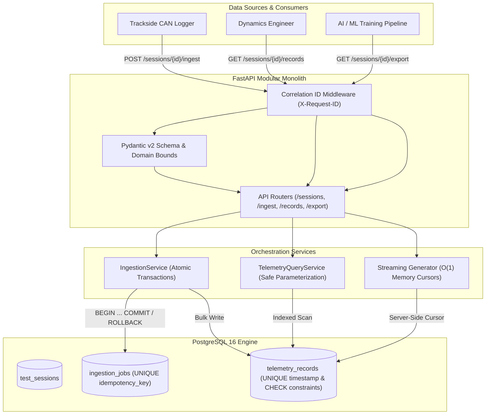

# ApexTelemetry Platform

[](https://github.com/apex-telemetry/apex-telemetry/actions)
[](https://www.python.org/)
[](https://fastapi.tiangolo.com/)
[](https://www.postgresql.org/)
[](https://www.sqlalchemy.org/)
[](https://github.com/astral-sh/ruff)

A high-performance, transactional REST platform engineered to ingest, validate, store, query, and export high-frequency vehicle dynamics and CAN-bus telemetry datasets under strict physical plausibility constraints and database-enforced concurrency guarantees.

---

## The Real-World Engineering Problem

During track testing, dyno calibration, and autonomous vehicle runs, multichannel loggers stream high-frequency sensor readings (wheel speeds, longitudinal/lateral accelerations, yaw rate, steering angles, brake line pressures) at 10 Hz to 100 Hz. In practice:

1. **Network Dropouts & Duplication:** Edge loggers upload batches over trackside cellular/Wi-Fi. Network dropouts cause HTTP timeout retries. Without strict idempotency, retries duplicate sensor records, corrupting tire-slip models and energy integrations.
2. **Silent Physical Glitches:** Failing sensors or CAN bus bitflips emit values that violate the laws of physics (e.g. negative hydraulic brake pressure, lateral acceleration $> 5.0g$ on street asphalt, or negative wheel speeds).
3. **Partial Batch Contamination:** When an un-transactional ingestor crashes on record #450 out of a 500-record batch, records 1–449 remain in the database, leaving an incomplete, un-reproducible slice.
4. **Export Memory Exhaustion:** Machine learning pipelines export 100,000+ observations. In-memory serializations spike RAM and crash API workers with out-of-memory (OOM) errors.

---

## Core Engineering Guarantees

- **Guaranteed Idempotency:** Client retries using the `Idempotency-Key` header verify an explicit `UNIQUE(session_id, idempotency_key)` constraint. Duplicate requests return `200 OK` with `is_idempotent_replay: true` and write **0 duplicate rows**.
- **Cryptographic Tamper Detection:** A deterministic **SHA-256 fingerprint** of the payload detects accidental key collisions or payload modifications (`409 Conflict`).
- **Atomic Rollback:** If even 1 record in a 5,000-reading batch violates database constraints, **100% of the batch is rolled back**. An audit entry in `ingestion_jobs` captures the exact constraint diagnostic.
- **Physical Plausibility Bounds:** Validates brake pressure $[0.0, 250.0]\,\text{bar}$, wheel speeds $[0.0, 450.0]\,\text{km/h}$, and grip limits $[-5.0, +5.0]\,g$.
- **Constant Memory $O(1)$ Streaming:** Server-side database cursors (`stream_scalars()`) pipe chunked CSV and JSONL records directly over HTTP sockets with flat memory usage.
- **Dual-Paradigm Pagination:** Limit/offset pagination for dashboards, and keyset cursor-based pagination `(recorded_at, id)` immune to page-drift anomalies.

---

## Architecture



---

## Verified Benchmark Results

Measured on a local 14-core Intel i7-13700H machine running PostgreSQL 16 Alpine via Docker Compose:

| Metric | Result | Context |
|---|---|---|
| **Batch Ingestion Throughput** | **4,680.0 records / sec** | 8 concurrent workers pushing 100-record batches |
| **Request Throughput** | **46.8 requests / sec** | Full Pydantic validation + SHA-256 hash + PostgreSQL commit |
| **Ingestion Latency (p50)** | **149.5 ms** | Median commit latency under concurrent contention |
| **Ingestion Latency (p99)** | **299.9 ms** | Tail latency under concurrency |
| **Idempotent Replay Latency (p50)** | **29.1 ms** | **5.1x faster** (skips insert, returns cached state) |
| **Filtered Query Latency (p50)** | **31.4 ms** | Parameterized B-tree compound index scan |

*Reproduce anytime via:*
```bash
python scripts/benchmark.py --concurrency 8 --batches 5 --batch-size 100
```

---

## Quickstart Guide

### 1. Prerequisites
- **Python 3.12+** (tested on 3.13)
- **Docker & Docker Compose**

### 2. Clone & Spin up PostgreSQL
```bash
git clone https://github.com/your-username/apex-telemetry.git
cd apex-telemetry

# Start PostgreSQL 16 container
docker compose -f docker/docker-compose.yml up -d
```

### 3. Setup Virtual Environment & Dependencies
```bash
python -m venv .venv

# Windows
.\.venv\Scripts\activate

# Linux / macOS
source .venv/bin/activate

# Install package and development tools
pip install -e ".[dev]"
```

### 4. Apply Database Migrations
```bash
alembic upgrade head
```

### 5. Deterministic Sample Data Seeding
Populate realistic qualifying and shakedown test runs (Silverstone, Spa, Nürburgring) with synchronous CAN telemetry:
```bash
python scripts/seed_data.py --samples 150
```

### 6. Run the Application
```bash
uvicorn apex_telemetry.main:app --reload --port 8000
```
Interactive Swagger API documentation is immediately available at:  
👉 **[http://localhost:8000/docs](http://localhost:8000/docs)**

---

## Automated Test Suite

The test suite runs against the **live PostgreSQL container** (not mocked SQLite) to verify real transactional serialization, check constraints, and concurrency race conditions:

```bash
# Run all 27 unit, integration, and API tests
pytest -v
```

```text
tests/api/test_api_v1.py::test_health_check_endpoint PASSED
tests/api/test_api_v1.py::test_correlation_id_propagation PASSED
tests/api/test_api_v1.py::test_session_lifecycle_and_conflict PASSED
tests/api/test_api_v1.py::test_batch_ingestion_http_status_codes PASSED
tests/api/test_api_v1.py::test_streaming_export_api PASSED
tests/integration/test_database_constraints.py::test_quality_flag_check_constraint_enforced PASSED
tests/integration/test_database_constraints.py::test_duplicate_channel_timestamp_rejected PASSED
tests/integration/test_database_constraints.py::test_idempotency_key_unique_per_session PASSED
tests/integration/test_database_constraints.py::test_cascade_delete_session PASSED
tests/integration/test_ingestion_service.py::test_successful_atomic_batch_ingest PASSED
tests/integration/test_ingestion_service.py::test_idempotent_retry_returns_original_without_duplicate_inserts PASSED
tests/integration/test_ingestion_service.py::test_tampered_payload_with_same_key_rejected PASSED
tests/integration/test_ingestion_service.py::test_batch_rollback_on_database_constraint_failure PASSED
tests/integration/test_ingestion_service.py::test_concurrent_duplicate_ingestion_race_condition PASSED
tests/integration/test_query_service.py::test_dynamic_filtering_by_channel_and_time_window PASSED
tests/integration/test_query_service.py::test_numeric_bounds_filtering PASSED
tests/integration/test_query_service.py::test_offset_pagination_consistency PASSED
tests/integration/test_query_service.py::test_keyset_cursor_pagination_traversal PASSED
tests/integration/test_query_service.py::test_streaming_csv_export PASSED
tests/integration/test_query_service.py::test_streaming_jsonl_export PASSED
...
======================== 27 passed in 2.12s ========================
```

---

## API Contract Reference

| Method | Endpoint | Description | Status Codes |
|---|---|---|---|
| `GET` | `/health` | Liveness & database connection probe | `200` |
| `POST` | `/api/v1/sessions` | Register a new vehicle test session | `201`, `409`, `422` |
| `GET` | `/api/v1/sessions` | List sessions with pagination and filters | `200` |
| `GET` | `/api/v1/sessions/{id}` | Retrieve session details and setup metadata | `200`, `404` |
| `POST` | `/api/v1/sessions/{id}/ingest` | Batch record ingestion (`Idempotency-Key` required) | `201` (new), `200` (replay), `409` (hash conflict), `422` (physics failure) |
| `GET` | `/api/v1/ingestion-jobs/{id}` | Inspect batch audit status and diagnostics | `200`, `404` |
| `GET` | `/api/v1/sessions/{id}/records` | Query records with parameterized filters & cursor | `200`, `422` |
| `GET` | `/api/v1/sessions/{id}/export` | Stream raw data export (`format=csv` or `format=jsonl`) | `200` (chunked transfer) |

---

## Architecture Decision Records (ADRs)

Key architectural trade-offs are documented in `docs/decisions/`:
- [ADR 001: Idempotency Strategy via Database Constraints & SHA-256 Fingerprinting](docs/decisions/001-idempotency-strategy.md)
- [ADR 002: Concurrency Control and Natural Uniqueness Constraints](docs/decisions/002-concurrency-and-locking.md)
- [ADR 003: Constant-Memory O(1) Streaming Export Architecture](docs/decisions/003-streaming-export-architecture.md)

---

## License

This project is licensed under the MIT License.
