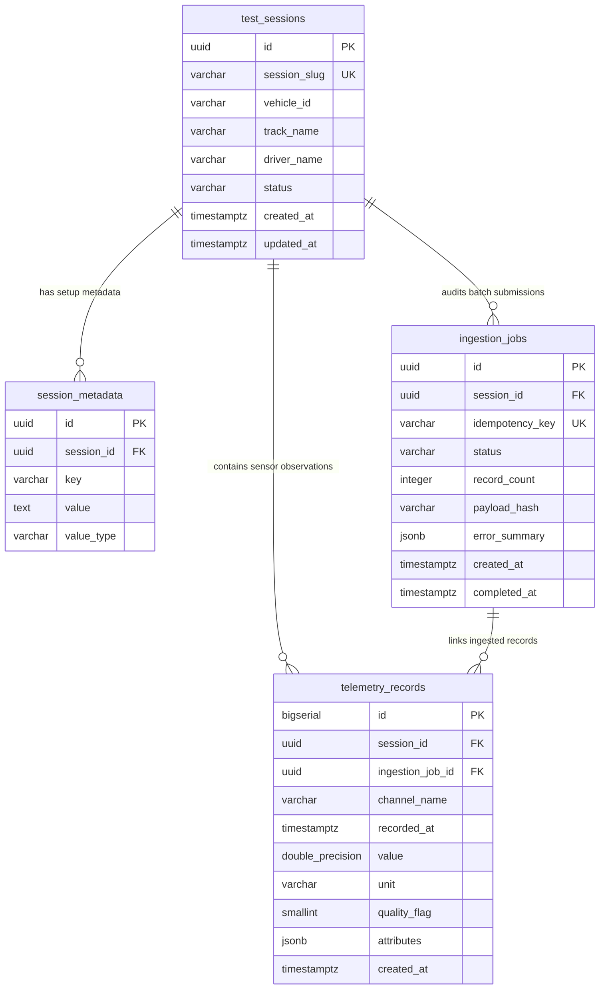
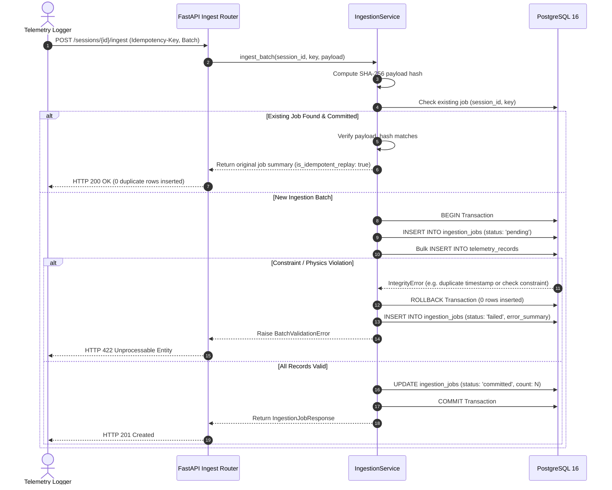
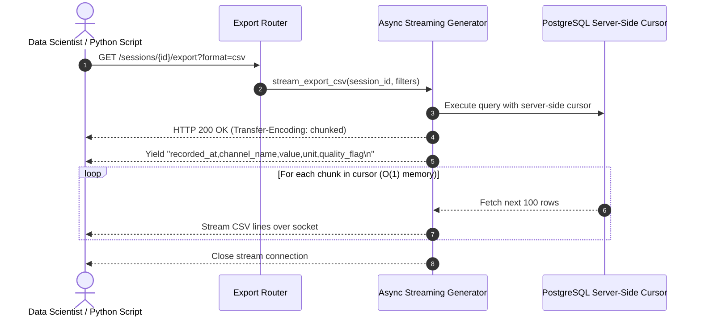

# ApexTelemetry Architecture & System Design

ApexTelemetry is a high-performance, transactional REST platform for ingesting, validating, querying, and exporting high-frequency vehicle dynamics and CAN-bus telemetry data.

---

## 1. High-Level Component Architecture

```mermaid
flowchart TD
    subgraph Clients["Edge Loggers & Analysts"]
        A1["Automated CAN Logger (Trackside)"]
        A2["Vehicle Dynamics Engineer"]
        A3["AI / ML Training Pipeline"]
    end

    subgraph API["FastAPI Presentation Layer"]
        B1["Correlation ID Middleware (X-Request-ID)"]
        B2["Pydantic v2 Request Validation & Physics Bound Checks"]
        B3["Global Exception Handlers (RFC 7807)"]
        B4["OpenAPI / Swagger UI (/docs)"]
    end

    subgraph Services["Domain & Orchestration Services"]
        C1["IngestionService (Atomic Transactions, SHA-256 Idempotency)"]
        C2["SessionService (Session Lifecycle & Metadata)"]
        C3["TelemetryQueryService (Safe Dynamic Query Builder)"]
        C4["ExportService (Server-Side Streaming Cursor)"]
    end

    subgraph Storage["PostgreSQL 16 Engine"]
        D1[("test_sessions")]
        D2[("session_metadata")]
        D3[("ingestion_jobs (UNIQUE idempotency_key)")]
        D4[("telemetry_records (UNIQUE timestamp & CHECK constraints)")]
    end

    A1 -->|"POST /sessions/{id}/ingest + Idempotency-Key"| B1
    A2 -->|"GET /sessions/{id}/records"| B1
    A3 -->|"GET /sessions/{id}/export?format=jsonl"| B1

    B1 --> B2 --> C1
    B1 --> C2
    B1 --> C3
    B1 --> C4

    C1 -->|Atomic Commit / Rollback| D3
    C1 -->|Bulk Insert| D4
    C2 --> D1
    C2 --> D2
    C3 -->|Indexed Range Scan| D4
    C4 -->|stream_scalars() Chunked Read| D4
```

---

## 2. Relational Schema & Entity-Relationship (ER) Diagram



---

## 3. Atomic Ingestion & Concurrency Flow



---

## 4. Constant Memory Streaming Flow


